# FM27 como referência — o que pegar para o Trem Soccer

Fonte: as 135 screenshots do FM27 reunidas no FMScout (https://www.fmscout.com/a-football-manager-2027-screenshots.html). Olhei umas 25, as das telas que têm equivalente nosso. Deixei de fora 3D, estádio, torcida, cutscenes e o criador de técnico. As imagens citadas estão em `2026-10-26-fm27-referencias/`.

## Leitura geral

O FM27 é uma grade escura de painéis do mesmo peso: o portal tem 8 blocos lado a lado e a partida tem 12. É o contrário da nossa regra de **um ponto focal por tela**. O layout não serve para nós. O que serve são **peças**: régua de efetividade, achados com "expandir", boletim com nota em letra, faixa de deadline day e sorteio ao vivo.

## Parte 1 — visual, tela por tela

| Nossa tela | FM27 | Pegar | Não pegar | Esforço |
|---|---|---|---|---|
| **Central** | 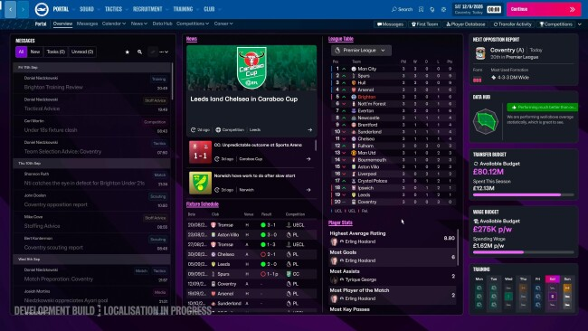 | No "Next opposition report", a forma em 3 quadradinhos coloridos e a "formação mais usada" numa linha só, para enriquecer as fichas do adversário. No Data Hub, **uma frase** de resumo com um selo verde ("rendendo bem acima da média"); combina com o lede do Vestiário. | As 6 colunas do mesmo peso. | P |
| **Elenco** | 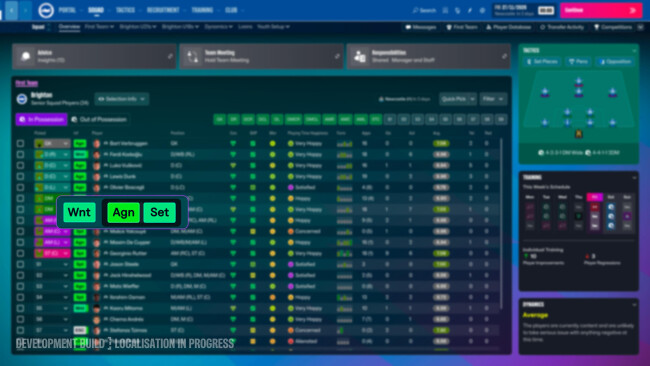 | **Pílulas de status com 3 letras** na linha do jogador (Wnt, Agn, Set). Para nós: LES (lesionado), SUS (suspenso), VEN (à venda), EST (estudando posição, `treino.js` `posicaoEmEstudo`), NOV (recém-chegado). Elas dizem tudo sem abrir a ficha. | A tabela com 20 colunas. | P |
| **Ficha / página do jogador** | 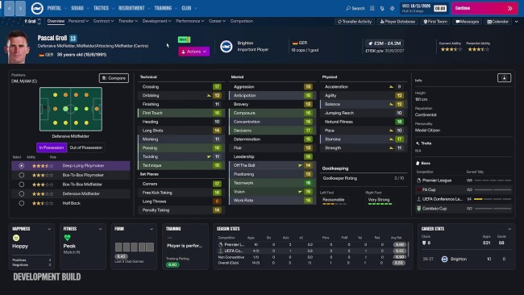 | **Setinha de tendência** ao lado do atributo que subiu ou caiu no treino recente. **Forma = 5 barrinhas** com as notas dos últimos 5 jogos. Rodapé em blocos curtos: felicidade, forma, treino, temporada. | Atributos 1–20 com o fundo todo colorido. | M |
| **Tática** | 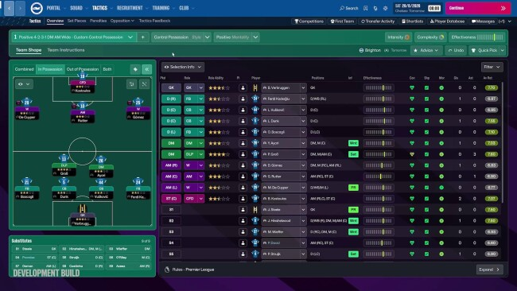 | **Régua de efetividade**: tracinhos com um marcador colorido, em cada linha do jogador e no topo para o time. Visual compacto para o que já calculamos: `notaNaPosicao` × familiaridade e o entrosamento (`motor.js` `entrosamento`). | Os três medidores (intensidade, complexidade, efetividade) juntos no topo. | P–M |
| **Partida / relatório** | 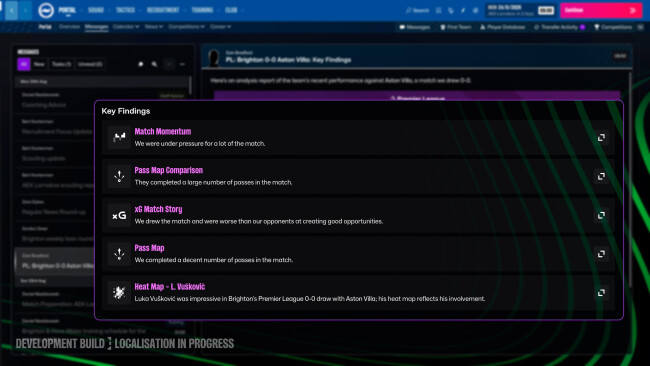 | **Achados do jogo**: 4 ou 5 linhas, cada uma com ícone, título colorido, **uma frase** e um botão de expandir que abre o gráfico. É o "um ponto focal + aprofundar" pronto. O texto já existe: `leiturasDoVestiario` (`src/leituras.js`) e a análise do analista (`src/relatorio.js`). | A grade de 12 painéis da partida ao vivo. | M |
| **Partida (régua)** | 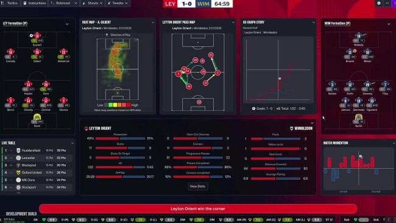 | Estatísticas em barras duplas (nós vermelho, eles azul) com o número de cada lado. **Já temos** a régua do último jogo (`ui-trem.js:81`), "Momento do jogo" e "Corrida do xG" (`ui-graficos.js`). Aqui só vale conferir que o nosso está tão limpo quanto. | Mapa de calor e mapa de passes: o motor não tem posição x/y, só zonas. O equivalente honesto é um **mapa de zonas** (`relatorio.zonas`). | — |
| **Competições** | 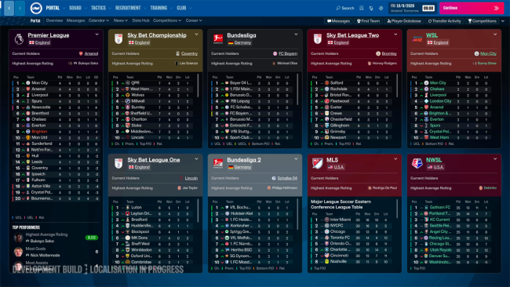 | Card por liga com o **cabeçalho na cor da competição**, o campeão atual e o destaque (maior média) acima do corte da tabela. Encaixa na Série A/B e nas copas. | Os 9 cards de uma vez. | M |
| **Copa (sorteio)** | 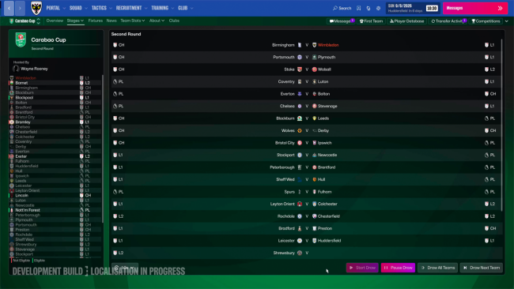 | **Sorteio ao vivo**: os confrontos aparecem um a um, com "Sortear próximo" / "Sortear todos". Para nós seria um **replay** do sorteio que o SQL já fez, só no front. Bom para a liga dos amigos assistir junto. | — | M |
| **Mercado** | 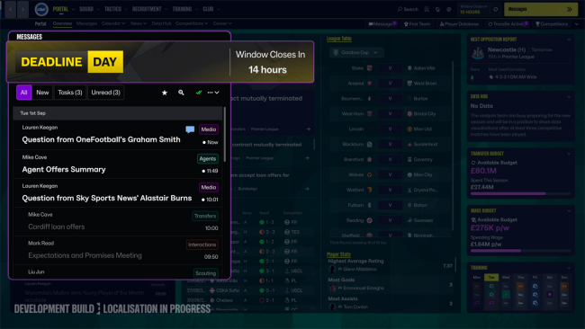 | Faixa **DEADLINE DAY** (preto e amarelo) com "a janela fecha em 14 horas". Mesma família do carimbo e da boleta. Vale no último dia de janela. | — | P |
| **Diretoria** | 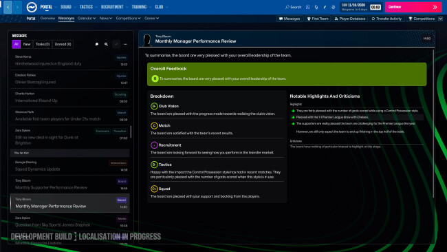 | **Boletim com nota em letra** (B−, C, C+) por área (resultados, tática, elenco, mercado) e uma frase cada, mais destaques e críticas. Dá corpo à confiança que já calculamos (`src/diretoria.js` `variacaoDaConfianca`, `fraseDoPresidente`). | — | M |
| **Notícias** | 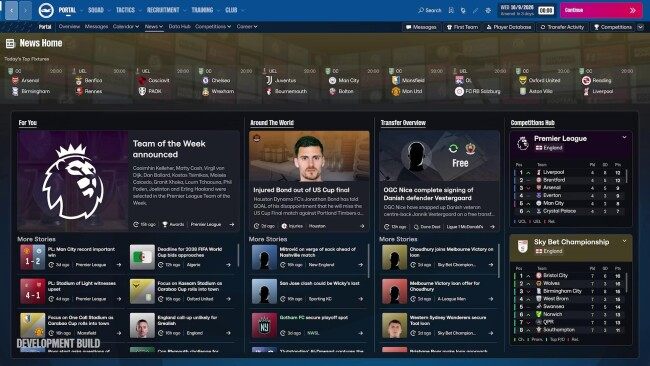 | **Faixa com os jogos do dia** no topo, e as colunas "Pra você" (o seu clube) e "Pela liga". | As 4 colunas iguais. | M |

## Parte 2 — mecânicas do FM27 que caberiam aqui

| Mecânica do FM27 | Como ficaria no Trem Soccer | Onde mexe | Esforço | Valor |
|---|---|---|---|---|
| **Efetividade tática** (compreensão × capacidade × adesão × info do adversário) 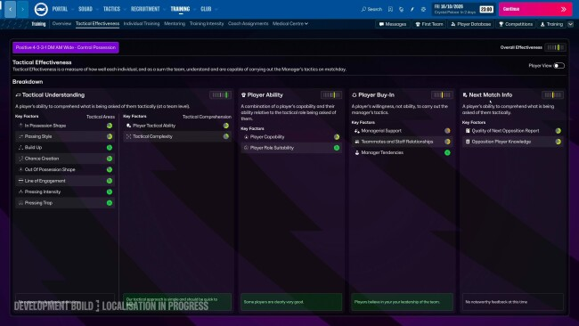 | Um medidor de **"Prontidão do time"** na Tática, somando nota na posição, familiaridade, entrosamento e o relatório do analista sobre o adversário. Usa só dados que já existem; nada muda no motor. | `ui-escalacao.js` e Tática | M | Alto |
| **Achados pós-jogo** (key findings) | Lista de achados no relatório e no Vestiário, com expandir. As frases já saem de `leituras.js`. | `ui-relatorio.js`, `relatorio.html`, Central | P–M | Alto |
| **Revisão mensal do técnico** | **Boletim da diretoria** a cada N rodadas, com notas em letra por área. A comparação entre amigos ("tirei B−, você tirou D") é o tempero. | `diretoria.js` + Central; se quiser histórico, um SQL para guardar | M | Alto |
| **Gritos / reações ao vivo** 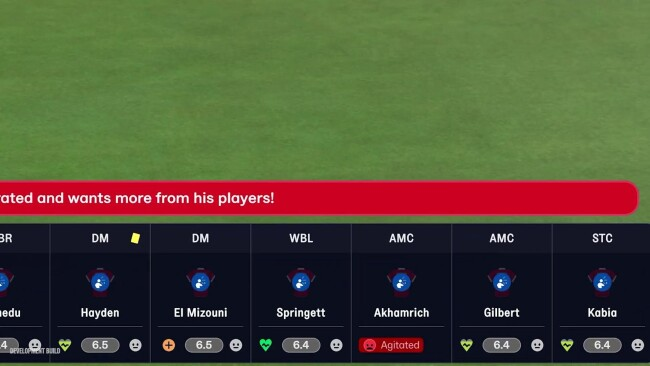 | **Não dá do jeito deles**: a partida é simulada no servidor antes, e o ao vivo é replay. A versão possível é um **plano de jogo condicional** escolhido antes ("perdendo aos 70' → pra cima"; "ganhando por 2 → fechar"), aplicado pelo motor de forma determinística. | `motor.js` (instruções) + função `rodada` + SQL da escalação + Tática | G | Alto |
| **Pílulas de status** | Ver Parte 1, Elenco. | `jogo.html` (elenco) | P | Médio |
| **Sorteio de copa ao vivo** | Replay animado do sorteio já feito. | Front (Competições) | M | Médio |
| **Deadline day** | Faixa e contagem no último dia de janela; notícias de "fechou no fim". | Mercado/Central | P | Médio |
| **Complexidade tática** | Instruções extremas exigiriam mais entrosamento. Mexe na calibragem do motor; **deixar para depois**. | `motor.js` | G | Médio |
| **Dinâmica do elenco** (hierarquia, grupos) 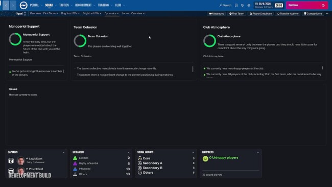 | Fora de escopo por ora: precisa de um modelo de personalidade que não temos. | — | G | Baixo |
| **Treino individual / foco** | **Já temos** (`treino.js` `FOCOS`, `focoDoJogador`, aprender posição). | — | — | — |
| **Momento do jogo / corrida do xG** | **Já temos** (`ui-graficos.js`). | — | — | — |
| **Continue flow** | Não se aplica: a liga roda em horário fixo. | — | — | — |

Todas as ideias acima respeitam o determinismo: nada de `Math.random()` no motor. Gritos e complexidade tática são as únicas que mexem no motor, e precisariam passar pela calibragem.

## Top 5 recomendado (em ordem)

1. **Achados do jogo** no relatório e no Vestiário. Barato, o texto já existe, e é o maior ganho de leitura.
2. **Pílulas de status** no elenco. Uma tarde de trabalho e se vê na hora.
3. **Boletim da diretoria** com notas em letra. Tela nova com cara de evento, e gera conversa no grupo.
4. **Prontidão do time** (régua de efetividade) na Tática. Mostra o que o motor já considera e hoje fica escondido.
5. **Eventos de calendário**: deadline day e sorteio ao vivo. Teatro barato com carimbo e boleta.

O plano de jogo condicional (os "gritos" possíveis) é a feature de maior valor de jogo, mas é a mais cara, porque mexe em motor, função e SQL. Pede uma spec própria.
